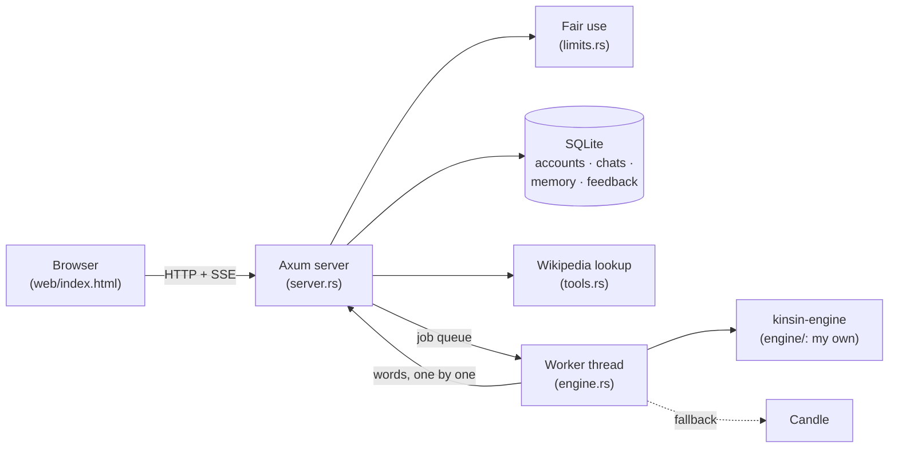

<p align="center">
  
</p>

<h1 align="center">kinSin</h1>

<p align="center">
  <b>A CPU-only LLM assistant in Rust, running on an inference engine I wrote from scratch.</b><br>
  No GPU. No cloud API. No ML library in the engine. Every word is computed on your own machine.
</p>

<p align="center">
  <a href="https://github.com/GAURI-cpu/RustLLM/actions/workflows/ci.yml"></a>
  
  
  
  
</p>

---

## What it is

kinSin is a ChatGPT-style assistant that runs on a normal laptop CPU. It has two parts:

- **kinsin-engine** (`engine/`): a transformer inference engine I wrote in Rust **without any ML
  library**. It reads the model file, unpacks the 4-bit weights, and runs attention, the KV cache and
  the feed-forward layers itself, with hand-written AVX2 kernels. Its only dependencies are `anyhow`
  and `rayon`.
- **The kinSin app** (`src/`, `web/`): an OpenAI-compatible streaming server and a full chat web app,
  with accounts, memory, Wikipedia lookups, photo reading and voice input.

The model weights are a fine-tuned **Qwen2.5-1.5B-Instruct**, quantized to 4 bits (Q4_0).
Hugging Face's [Candle](https://github.com/huggingface/candle) is kept as a reference to check my
engine's answers against, and as an automatic fallback.

## The engine, from scratch

| Part | What I wrote |
|---|---|
| **Model file** | A GGUF reader: header, metadata, tensor index, alignment |
| **Weights** | 12 storage types unpacked by hand (F16, BF16, Q4_0/1, Q5_0/1, Q8_0, Q2_K–Q6_K), checked against llama.cpp's reference code with golden tests |
| **Transformer** | RMSNorm, RoPE, grouped-query attention (12 query / 2 key-value heads), SwiGLU, KV cache, tied embeddings |
| **Kernels** | Fused dot products, **AVX2 SIMD**, integer maths against an 8-bit word (`maddubs`) for Q4_0, Q5_0, Q8_0 and Q4_K, a rayon thread pool |
| **Prefill** | The whole prompt in one batch: each weight row is read once, with causal attention, and the output layer runs only for the last word |

**Correctness:** `examples/compare_model.rs` runs both engines on the real model and checks that they
pick the **same next word at every step**. Unit tests cover every building block, and batched prefill
is tested against word-by-word decoding.

## Performance

kinSin 1.5B Q4_0 on my laptop (16 threads). Every step was **profiled first**, to find the real
bottleneck instead of guessing:

| Version | Reading a 33-word prompt | Writing |
|---|---:|---:|
| First working version | 76.3 s | 0.51 tok/s |
| + all cores, fused Q4_0 dot product | 5.9 s | 5.2 tok/s |
| + AVX2 SIMD | 4.6 s | 6.7 tok/s |
| + thread pool (thread start-up was eating ~70% of the time) | 1.9 s | 15.8 tok/s |
| + fast Q6_K output layer | 1.3 s | **24.4 tok/s** |

That's about **48× faster** than the first version.

### A fair race against Candle

`examples/race.rs` runs both engines **in the same program**: the same prompt, taking turns (so heat
and background apps hit both equally), the **median of 5 rounds**, timing only the maths.

| | kinsin-engine vs Candle |
|---|---|
| Prompt reading (prefill) | **level**: 1.06 s vs 1.07 s |
| Writing (decode) | **about 90–97%** of Candle's speed, depending on the run |

```bash
cargo run --release --example race -- models/kinsin-1.5b-v2-q4_0.gguf
```

### What I learned

- **Every optimisation moves the bottleneck.** AVX2 made the maths 7× faster, but the whole program
  only got 1.3× faster, until profiling showed that **starting threads** was the real cost. A thread
  pool then gave 2.5×.
- **Prefill is compute-bound, decode is memory-bound.** Integer kernels closed the prefill gap with
  Candle completely, because the CPU is busy multiplying. They didn't help decode, where the CPU
  mostly **waits for RAM** to deliver ~1 GB of weights per word.
- **Measure fairly.** The same laptop gave 26.7 tok/s one hour and 16 tok/s the next (heat, power
  mode). Only comparisons **within the same run** mean anything.

## Features of the app

| | |
|---|---|
| ⚡ **Streaming answers** | Words appear as they're generated (Server-Sent Events) |
| 🔌 **OpenAI-compatible API** | `/v1/chat/completions` and `/v1/models` |
| 📷 **Reads photos** | Attach, paste or drop an image: text is read with OCR ([ocrs](https://github.com/robertknight/ocrs)) |
| 🎙️ **Voice input** | Speech-to-text with Whisper on the CPU, plus read-aloud |
| 🔎 **Live knowledge** | Questions about current things are looked up on Wikipedia, with source links |
| 🧠 **Memory** | Remembers facts about each user ("my name is…", "remember that…"); users can see and delete them |
| 👍 **Learns from feedback** | 👍 / 👎 and user corrections are exported as a fine-tuning dataset (opt-in) |
| 👤 **Accounts** | Argon2 password hashing, HttpOnly session cookies, chats synced across devices |
| 🛡️ **Fair use** | One question at a time per person, hourly limits, and a live "You're #2 in line" |
| 🌗 **Web app** | Chat history, edit / regenerate, markdown + code blocks, light & dark theme, mobile layout |

## How it works



1. The browser sends the conversation to `/v1/chat/completions`.
2. The server checks fair-use limits, adds the user's memory to the system prompt, and, for questions
   about current events, puts what Wikipedia says in front of the question.
3. The job goes into a queue. A single **worker thread** owns the model, so the CPU is never fought
   over. Waiting users see their place in line.
4. The engine reads the whole prompt in one batch (**prefill**), then writes one word at a time
   (**decode**), sampling with temperature, top-k and a repeat penalty.
5. Each word is streamed back the moment it exists.

## Quick start

You need [Rust](https://rustup.rs) (stable). On Windows, also the Visual Studio C++ build tools.

```bash
git clone https://github.com/GAURI-cpu/RustLLM.git
cd RustLLM
```

**1. Get a model** into `models/`:
- Qwen2 GGUF weights, e.g. `qwen2.5-1.5b-instruct-q4_0.gguf` or `-q4_k_m.gguf` from
  [Qwen/Qwen2.5-1.5B-Instruct-GGUF](https://huggingface.co/Qwen/Qwen2.5-1.5B-Instruct-GGUF)
- `tokenizer.json` from [Qwen/Qwen2.5-1.5B-Instruct](https://huggingface.co/Qwen/Qwen2.5-1.5B-Instruct)

**2. (Optional) photo reading and voice:**
```bash
./scripts/download_ocr_models.sh      # Windows: .\scripts\download_ocr_models.ps1
```
For voice, put the files of [openai/whisper-base](https://huggingface.co/openai/whisper-base)
(`model.safetensors`, `config.json`, `tokenizer.json`) in `models/whisper/`.

**3. Run:**
```bash
cargo run --release -- --serve --model models/qwen2.5-1.5b-instruct-q4_0.gguf
```
Open **http://localhost:8080**. The terminal says which engine is running:
`Engine: kinsin-engine (my own, written from scratch)`.

**Chat with the engine alone**, without the server:
```bash
cargo run --release -p kinsin-engine --example chat -- models/qwen2.5-1.5b-instruct-q4_0.gguf models/tokenizer.json
```

### Options

| Flag | Default | What it does |
|---|---|---|
| `--model <path>` | | GGUF model file |
| `--tokenizer <path>` | `models/tokenizer.json` | Tokenizer |
| `--engine own\|candle` | `own` | My engine, or Candle. `own` falls back to Candle only if a file uses a storage type it doesn't know (e.g. the IQ types) |
| `--port <n>` | `8080` | HTTP port |
| `--context <n>` | `4096` | Max conversation length in tokens |
| `--db <path>` | `data/kinsin.db` | Accounts, chats, memory and feedback |
| `--guest-limit` / `--user-limit` | `20` / `100` | Messages per hour |
| `--no-live` | | Never contact Wikipedia |
| `--trust-proxy` | | Behind Cloudflare: read the visitor's real IP |
| `--secure-cookies` | | When serving over HTTPS |
| `--export-training <path>` | | Write the fine-tuning dataset and exit |

### API

```bash
curl http://localhost:8080/v1/chat/completions \
  -H "Content-Type: application/json" \
  -d '{"messages":[{"role":"user","content":"What is Rust?"}],"stream":true}'
```

## Design decisions

**Measure, don't guess.** Every speed change was checked with a profiler line (time in the layers vs
the output layer) and a fair race. Two of my guesses about the bottleneck were wrong, and the
measurements said so.

**Batching was measured before it was built.** In theory, serving several users at once is almost free.
On Candle's CPU kernels it gave only 1.3×, while each user got much slower. So the server uses a fair
queue with "your place in line" instead.

**One worker thread owns the model.** HTTP handlers send jobs over a channel, and the worker streams
words back. A request limit returns `429` instead of letting the queue grow forever, and abandoned
requests (closed tabs) are skipped.

**SQLite, not a database server.** One server needs no network database. All database code lives in
`accounts.rs`, so moving to PostgreSQL later would only touch that file.

**Security basics done properly.** Passwords use Argon2id. Session tokens are 32 random bytes, and
only their SHA-256 is stored. Cookies are `HttpOnly` + `SameSite=Lax`. Login errors are identical
(including timing) for an unknown email and a wrong password.

**Training data is filtered.** Only 👍 answers and user corrections are exported, and answers that
relied on looked-up Wikipedia text are left out, so the next model isn't taught to state facts it
can't see.

## Project structure

```
engine/                  kinsin-engine: my inference engine (no ML library)
  src/gguf.rs            reads the GGUF model file
  src/quant.rs           unpacking for 12 storage types, integer + AVX2 kernels, the packed QMatrix
  src/ops.rs             RMSNorm, softmax, SiLU / SwiGLU, RoPE
  src/model.rs           the Qwen2 transformer: layers, attention, KV cache, batched prefill
  examples/chat.rs       chat with the engine in the terminal
src/
  main.rs                command line: starts the server or the terminal chat
  engine.rs              one interface, two backends (my engine / Candle)
  sampler.rs             temperature, top-k, repeat penalty
  chat.rs                ChatML prompt format, keeps conversations inside the context window
  server.rs              Axum HTTP API, SSE streaming, job queue and worker
  limits.rs              fair use
  accounts.rs            SQLite: users, sessions, chats, memory, feedback, dataset export
  memory.rs              which facts to remember, and how they reach the model
  tools.rs               Wikipedia lookups
  ocr.rs · voice.rs      photo reading and Whisper speech-to-text
web/index.html           the whole web app (no framework, no build step)
examples/                compare_weights, compare_model, race, batch_bench
```

## Tests

```bash
cargo test --release
```

The tests cover the engine's building blocks (every storage type against llama.cpp's reference, the SIMD versions against the
plain ones, RMSNorm, softmax, RoPE's distance property), the HTTP API (streaming format, error cases,
queue positions), accounts and sessions, fair-use limits, memory rules, dataset export, and Wikipedia
lookups against a fake local server.

## Limits

- **Speed:** one answer at a time, roughly 15–25 tok/s on my laptop depending on its power mode. Fine
  for a demo or a small group, not for thousands of simultaneous users.
- **Formats:** my engine reads F32, F16, BF16, Q4_0, Q4_1, Q5_0, Q5_1, Q8_0 and Q2_K–Q6_K (so Q4_K_M and
  Q5_K_M files work). Q4_0, Q5_0, Q8_0, Q4_K and Q6_K have fast kernels; the rest are correct but slower.
  Only the rarer IQ formats fall back to Candle.
- **Knowledge:** a 1.5B model makes mistakes. Wikipedia helps with facts but lacks the latest hours.
- **Built on Qwen2.5:** the weights come from Alibaba's open model (Apache-2.0). The engine, server,
  app and fine-tuning are mine.

## Roadmap

- [x] My own inference engine, from scratch
- [x] Batched prefill, level with Candle
- [ ] **Roofline**: measure memory bandwidth, report % of the hardware limit
- [ ] Fewer parallel regions per word (fuse q/k/v and gate/up)
- [ ] Speculative decoding with the 0.5B model as the drafter
- [ ] Turn opted-in chats into a reviewed dataset, then train kinSin v0.4
- [ ] Live public demo

## Credits

- [Qwen2.5](https://huggingface.co/Qwen) by Alibaba Cloud (Apache-2.0): base model weights
- [Candle](https://github.com/huggingface/candle) by Hugging Face: reference and fallback engine
- [llama.cpp / GGML](https://github.com/ggml-org/llama.cpp): the GGUF format and quantization layouts
- [ocrs](https://github.com/robertknight/ocrs): OCR · [Whisper](https://github.com/openai/whisper) by OpenAI: speech recognition
- [Wikipedia](https://www.wikipedia.org): live knowledge

## Author

Built by **Gauri** (she/her) · [github.com/GAURI-cpu](https://github.com/GAURI-cpu)